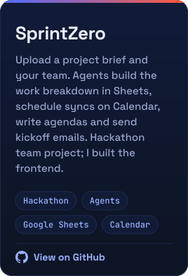
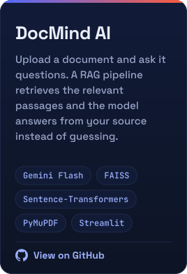
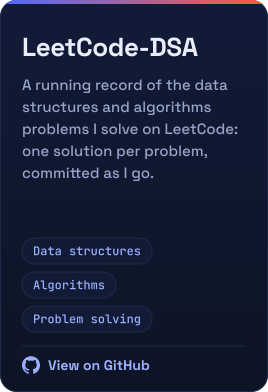
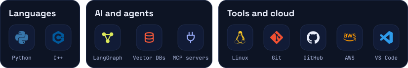

  

 

BSCS student at the University of Karachi, training to be an AI engineer. I'm learning how production-grade AI systems are built, from retrieval and agents to evaluation and operations, and I build small, complete projects to learn each part.

I'm also interested in AI security: how LLM-based systems fail, and how to make them fail safely.

Based in Karachi, Pakistan. Open to AI engineer and software engineer roles.

 

 

SprintZero: <a href="https://sprintzero-405521331.asia-south1.run.app/">live app</a> · <a href="https://youtu.be/i08lSN-7CpY">demo video</a> · <a href="https://devpost.com/software/sprint-zero">Devpost</a>

 

<picture>
  <source media="(max-width: 700px)" srcset="assets/stack-mobile.svg">
  
</picture>

 

